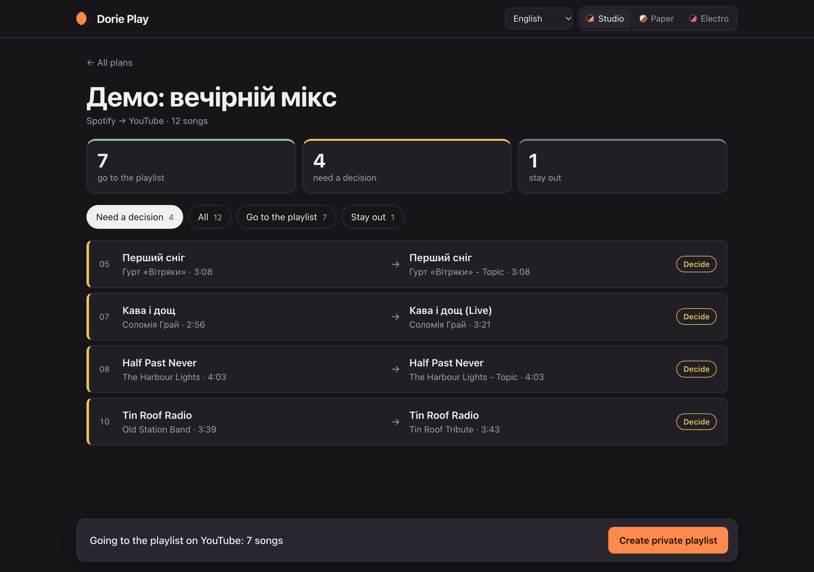
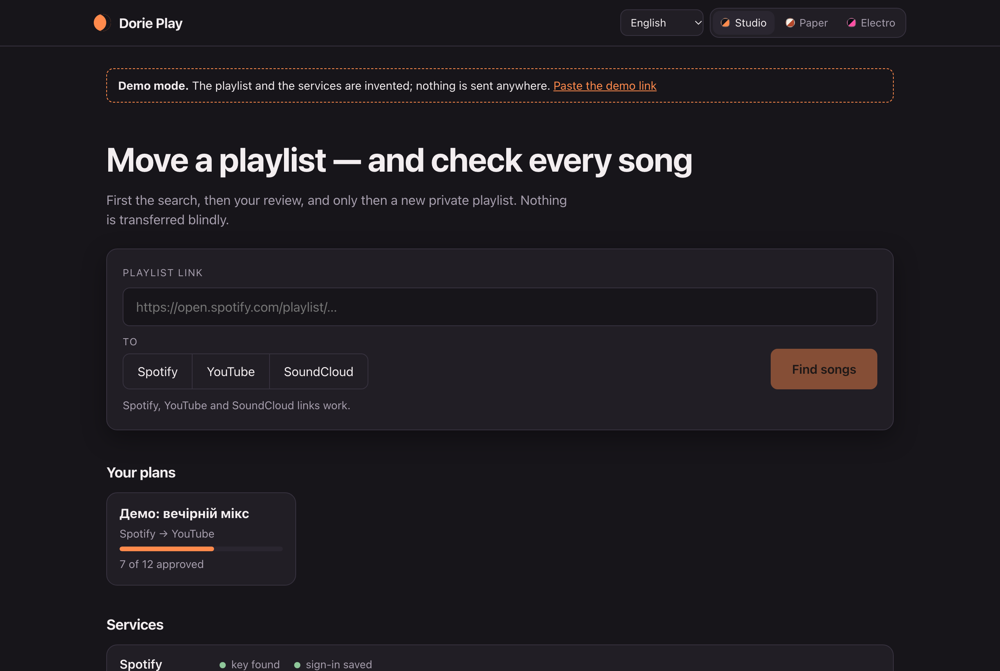

# Dorie Play

Move your playlists between **Spotify**, **YouTube** and **SoundCloud** — in any direction — and
check every song before anything is transferred.

[Українською](README.uk.md)

Dorie Play runs on your own computer. It first only *searches*; you review the matches; only then
it creates a new **private** playlist from the songs you approved. Nothing is transferred blindly,
and nothing is sent to anyone except the music services themselves.





> Not affiliated with Spotify, YouTube, Google or SoundCloud. The screenshots show the built-in demo with an invented playlist.

## What you need (read this first)

There is no shared server and no shared keys: you connect the services with **your own** API keys.

| Service | What you need |
|---|---|
| Spotify | A free developer app (Client ID). The app owner needs Spotify Premium. Only playlists you own or collaborate on can be read. |
| YouTube | A Google Cloud project with YouTube Data API v3. About **100 searches a day**, so a long playlist going *to* YouTube takes several days (the program continues where it stopped). |
| SoundCloud | API keys, which SoundCloud gives only to Artist Pro subscribers. |

You only need keys for the two services you transfer between. Python 3.10 or newer.

## Try it without keys

```sh
python3 -m venv .venv
source .venv/bin/activate
pip install -r requirements.txt
python server.py --demo
```

The demo opens in your browser with an invented playlist and fake services, so you can click
through the whole flow.

## Use it

```sh
python server.py
```

The page opens at `http://127.0.0.1:8765` and is reachable only from your computer.

1. Paste a playlist link and choose where to transfer it.
2. Wait for the search. Confident matches are approved automatically.
3. Review the songs that need a decision: listen, pick a candidate, or leave the song out.
4. Press **Create private playlist** and confirm.

The interface is available in English, Ukrainian, Dutch, Russian and Spanish.

Prefer the terminal? The same three steps:

```sh
python dorieplay.py plan 'PLAYLIST_LINK' --to youtube --plan my.json
python dorieplay.py review --plan my.json
python dorieplay.py apply --plan my.json
```

## Connecting the services

**Spotify**

1. Create an app at https://developer.spotify.com/dashboard and tick *Web API*.
2. Add the redirect URI `http://127.0.0.1:8888/callback`.
3. Set the Client ID before starting the program (no client secret is needed):

```sh
export SPOTIPY_CLIENT_ID='your_client_id'
```

**YouTube**

1. Create a project at https://console.cloud.google.com/ and enable *YouTube Data API v3*.
2. Google Auth Platform → Audience: External; add yourself as a test user.
3. Clients → Create client → *Desktop app* → download the JSON and save it as
   `google-client.json` in the program folder.

While the Google app is in *Testing*, Google asks you to sign in again about once a week.

**SoundCloud**

1. Create an app at https://soundcloud.com/you/apps with the redirect URI
   `http://127.0.0.1:8890/callback`.
2. Copy `soundcloud-client.example.json` to `soundcloud-client.json` and fill in your values.

The first time a service is used, a sign-in page opens in your browser. Sign in on the same
computer that runs the program.

## Good to know

- Search answers are kept for 30 days in `.search-cache.json`, so planning the same songs again
  does not spend the daily YouTube limit. Add `--no-cache` to `dorieplay.py plan` to search again.
- Running the transfer twice adds only what is missing; it does not create duplicates.
- Songs a service refuses (for example a deleted video) are skipped and listed at the end.
- Matching is a heuristic (title, artist, length). Live versions, remixes, covers and sped-up edits
  are not approved automatically. Cyrillic names are transliterated, so "Иван Дорн" matches
  "Ivan Dorn".
- Spotify-generated playlists (Daily Mix, Discover Weekly) and YouTube Mixes cannot be read: copy
  the songs into a playlist of your own first.
- A SoundCloud playlist holds at most 500 tracks.

## Your data

Keys, sign-in tokens, plans and the search cache stay in the program folder on your computer.
**Never publish** `google-client.json`, `soundcloud-client.json`, any `*token*` file, your plans or
your Spotify Client ID. The included `.gitignore` already excludes them.

## Development

```sh
python -m unittest discover tests
```

The tests need no network and no keys. Adding a service means adding one module in `platforms/`
with the functions described in `platforms/__init__.py`.

## License

[PolyForm Noncommercial 1.0.0](LICENSE). In short: you may use, study and change Dorie Play for
personal and other non-commercial purposes, free of charge. Selling it, or using it in a paid
product or service, needs written permission from the author. The source is published so you can
see exactly what runs on your computer; this is "source-available", not an open-source licence.

Pull requests are not accepted at the moment; bug reports and ideas in Issues are welcome.
