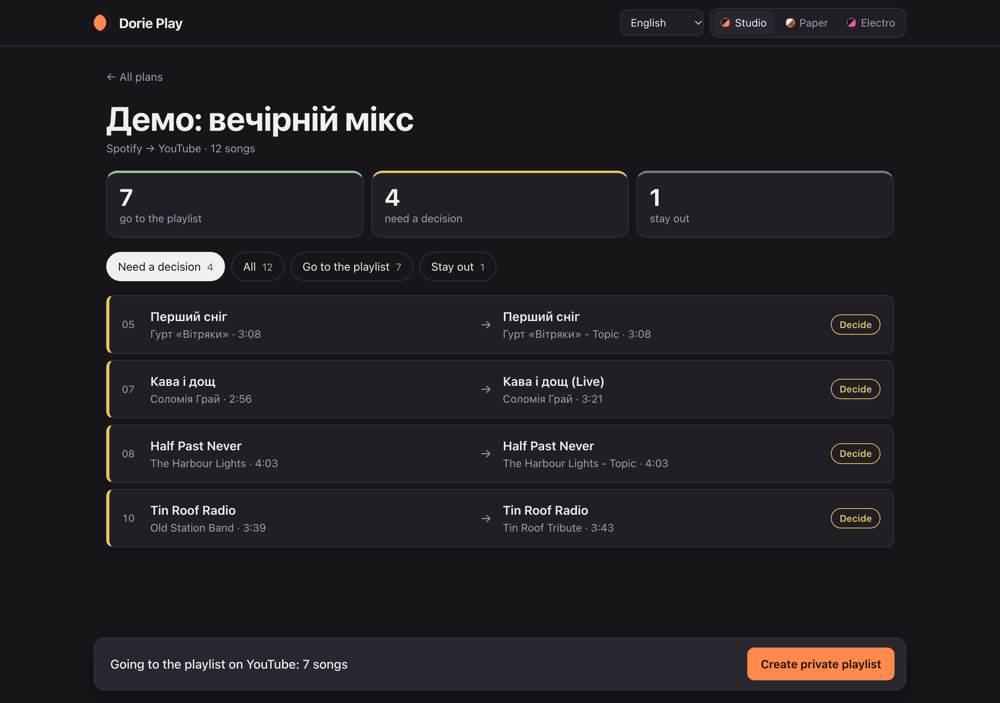

# Dorie Play — перенесення плейлистів між платформами



Платформи: **Spotify**, **YouTube**, **SoundCloud**, у будь-якому напрямку.
Звідки — визначається за посиланням. Куди — параметр `--to spotify|youtube|soundcloud`;
без нього Spotify → YouTube, YouTube → Spotify, SoundCloud → Spotify.

Скрипт спочатку тільки шукає й складає план (`plan`), ти його переглядаєш (`review`),
і лише потім він створює приватний плейлист (`apply`). Оцінка збігу — евристика:
назва, виконавець і тривалість; live/remix/cover, slowed/speed up, розбори,
реакції, альбоми й сніпети штрафуються. Кирилиця транслітерується, тож «Иван Дорн»
і «Ivan Dorn» вважаються одним виконавцем.

## Структура

```
dorieplay.py            команди plan / review / apply
matching.py            оцінка збігів, розбір назв відео YouTube
platforms/spotify.py   Spotify: читання, пошук, створення плейлиста
platforms/youtube.py   YouTube: те саме
platforms/soundcloud.py SoundCloud: те саме
```

Тести (без мережі й ключів): `python -m unittest discover tests`.

Нова платформа = новий файл у `platforms/` з тими самими функціями
(опис у `platforms/__init__.py`).

## Веб-інтерфейс

Те саме, що й команди нижче, але в браузері: встав посилання → перевір збіги → створи плейлист.

```sh
python server.py --demo
```

`--demo` показує вигаданий плейлист із несправжніми сервісами: ключі не потрібні, нічого нікуди
не надсилається. Без `--demo` програма працює зі справжніми сервісами (ключі ті самі, що для
команд). Сторінка відкривається на `http://127.0.0.1:8765` і доступна лише з цього комп'ютера.
Плани зберігаються в папці `plans/`. У правому верхньому куті — вибір мови (English, Українська,
Nederlands, Русский, Español) і три варіанти вигляду.

## Встановлення на Mac

```sh
python3 -m venv .venv
source .venv/bin/activate
pip install -r requirements.txt
```

## Підключення Spotify

1. Створи застосунок: https://developer.spotify.com/dashboard
2. Додай Redirect URI: http://127.0.0.1:8888/callback і познач Web API.
3. Задай Client ID (або один раз додай цей рядок у `~/.zshrc`):

```sh
export SPOTIPY_CLIENT_ID='твій_client_id'
```

Використовується PKCE, Client Secret не потрібен. Власник застосунку повинен мати
Spotify Premium. Раз на 6 місяців Spotify попросить увійти знову. Spotify віддає пісні лише з плейлистів, якими ти володієш або де ти
співавтор; згенеровані Spotify (Daily Mix, Discover Weekly, Radio) не читаються —
скопіюй пісні у свій плейлист.

Скрипт просить дозвіл і на читання, і на створення плейлистів. Якщо раніше ти
дозволяв лише читання, Spotify один раз попросить підтвердити нові дозволи.

## Підключення Google

1. Створи проєкт у https://console.cloud.google.com/
2. Увімкни YouTube Data API v3.
3. Google Auth Platform: Audience — External, Testing, додай себе в Test users.
4. Clients → Create client → Desktop app → Download JSON → збережи як google-client.json.

Поки застосунок у статусі Testing, Google просить увійти знову раз на ~7 днів;
скрипт сам відкриє браузер. Не публікуй токени, google-client.json і плани в Git.

## Підключення SoundCloud

SoundCloud видає API-ключі лише власникам підписки **Artist Pro**.

1. Відкрий https://soundcloud.com/you/apps і створи застосунок (назва, опис, сайт —
   можна посилання на свій GitHub).
2. Redirect URI: `http://127.0.0.1:8890/callback`
3. Створи в папці проєкту файл `soundcloud-client.json`:

```json
{
  "client_id": "твій_client_id",
  "client_secret": "твій_client_secret",
  "redirect_uri": "http://127.0.0.1:8890/callback"
}
```

Під час першого запуску відкриється вхід у SoundCloud. Токен зберігається в
`.soundcloud-token.json` і оновлюється сам. Не публікуй ці два файли.

Особливості SoundCloud:
- читаються плейлисти за посиланням `soundcloud.com/<user>/sets/<назва>`
  (і короткими `on.soundcloud.com/...`), зокрема приватні за секретним посиланням;
  лайки й профіль — ні;
- плейлист вміщує максимум 500 треків;
- на SoundCloud багато перезаливів, тому частіше буде review; якщо в треку є ISRC
  (код запису), пошук у Spotify знаходить точний запис за ним.

## Як переносити

```sh
python dorieplay.py plan 'посилання_на_плейлист' --plan назва.json
# або з явною ціллю, наприклад Spotify → SoundCloud:
python dorieplay.py plan 'посилання_spotify' --to soundcloud --plan назва.json
python dorieplay.py review --plan назва.json
python dorieplay.py apply --plan назва.json
```

- `plan` нічого не змінює. Якщо перервався (наприклад, закінчилась квота YouTube),
  та сама команда продовжить з місця зупинки. Готовий чи вже перенесений план не
  перезаписується без `--force`.
- Відповіді пошуку зберігаються на 30 днів у `.search-cache.json`, тож повторний `plan` тих самих
  пісень не витрачає денний ліміт YouTube. Шукати заново: додай `--no-cache`.
- `review` показує пісні, які треба вирішити вручну, з посиланнями на всіх кандидатів.
- Щоб взяти іншого кандидата: у файлі плану для пісні впиши його `id` (або посилання
  на нього) у `match_id` і постав `"approved": true`. `false` — пісню пропустити.
  Редагуй у VS Code або `nano`, не в TextEdit (він ламає лапки).
- `apply` створює приватний плейлист і додає схвалені пісні в порядку оригіналу.
  Повторний `apply` дописує лише те, чого ще немає. Не редагуй новий плейлист
  вручну, поки перенесення не завершено. Пісні, які платформа не прийняла
  (наприклад, відео видалили), `apply` пропускає й показує списком наприкінці.

Ключі й токени (`google-client.json`, `soundcloud-client.json`, `.spotify-token` тощо)
лежать у папці програми, з якої б папки ти її не запускав.

Плани, створені попередньою версією (поля `video_id`, `spotify_id`), читаються
автоматично.

## Квоти та обмеження

- YouTube: ліміти скидаються о 09:00 за Амстердамом. Пошук має окремий ліміт —
  100 пошуків на добу (тобто ~100 пісень у `plan`). Решта дій ділить 10 000 одиниць
  на добу: додавання пісні = 50 одиниць (~200 пісень на добу в `apply`).
  Читання плейлиста YouTube (для YouTube → Spotify) коштує копійки: ~2 одиниці на 50 відео.
- Spotify: пошук до 10 результатів на пісню, додавання пакетами по 100.
- SoundCloud: окремої денної квоти на пошук немає; при «429 Too Many Requests»
  скрипт сам чекає й повторює.
- YouTube Mix (посилання з `list=RD...`) API не читає — збережи відео у свій плейлист.
- Назви відео YouTube бувають довільними («Кино-Бездельник.avi»), тож для
  YouTube → Spotify виконавець і назва вгадуються з назви відео й каналу;
  такі пісні частіше потрапляють у review.

Apple Music поки не підтримується: його API вимагає платного Apple Developer Program.

## Ліцензія

[PolyForm Noncommercial 1.0.0](LICENSE): користуватись, вивчати й змінювати Dorie Play можна
безкоштовно для особистих та інших некомерційних цілей. Продаж або використання в платному продукті
чи сервісі — лише з письмового дозволу автора. Зміни від сторонніх (pull requests) поки не
приймаються; повідомлення про помилки та ідеї — в Issues.
